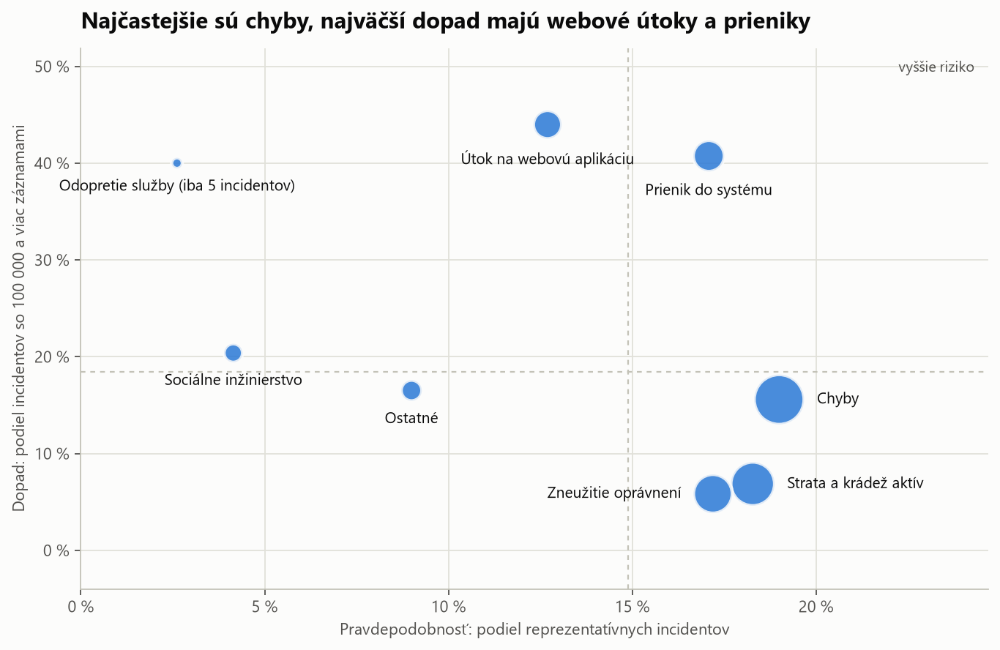
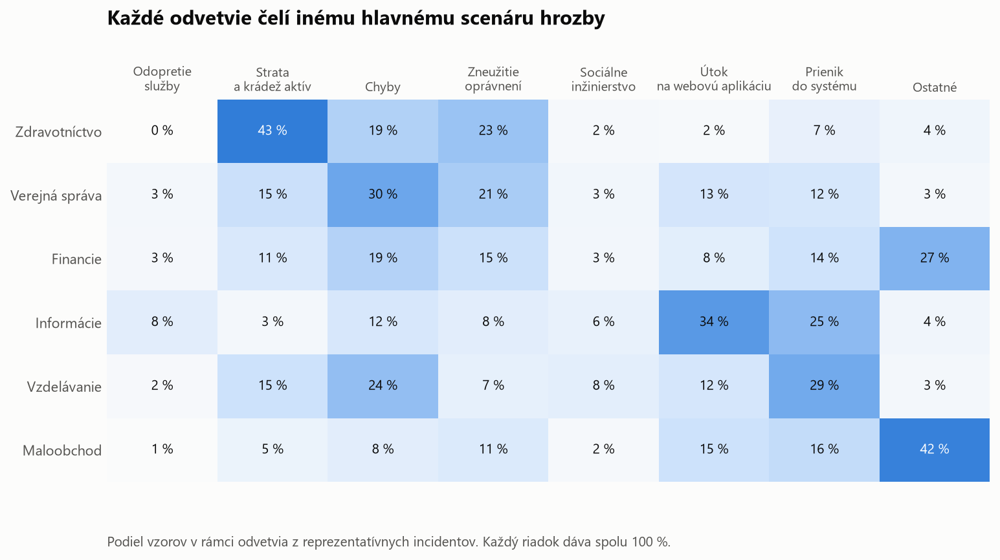
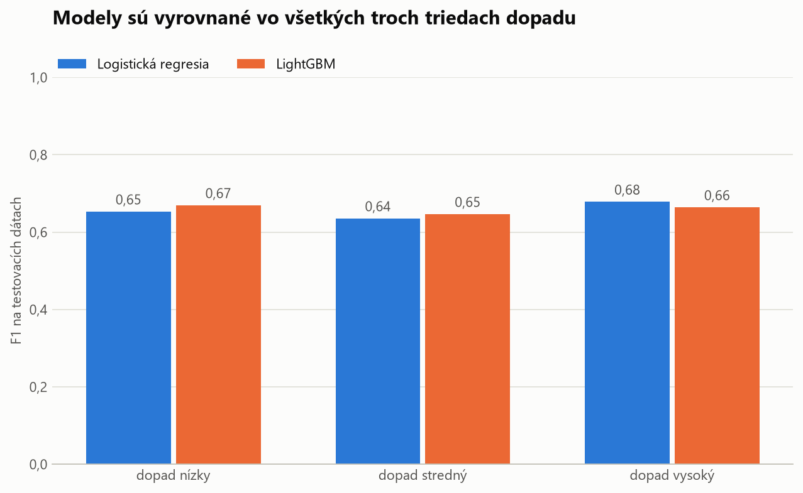
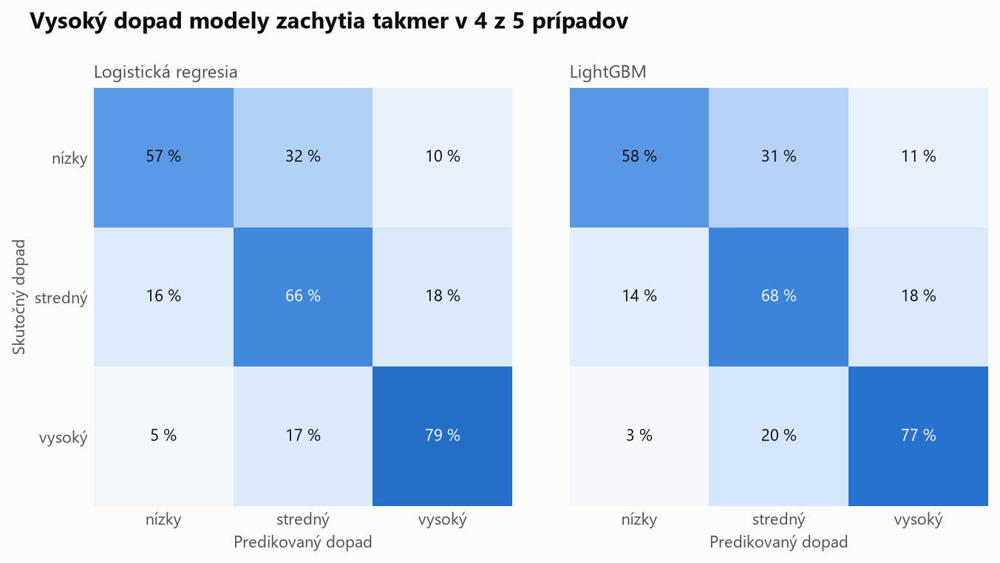
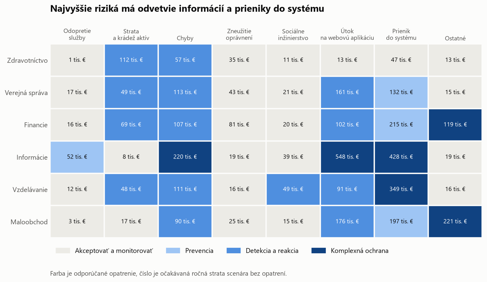
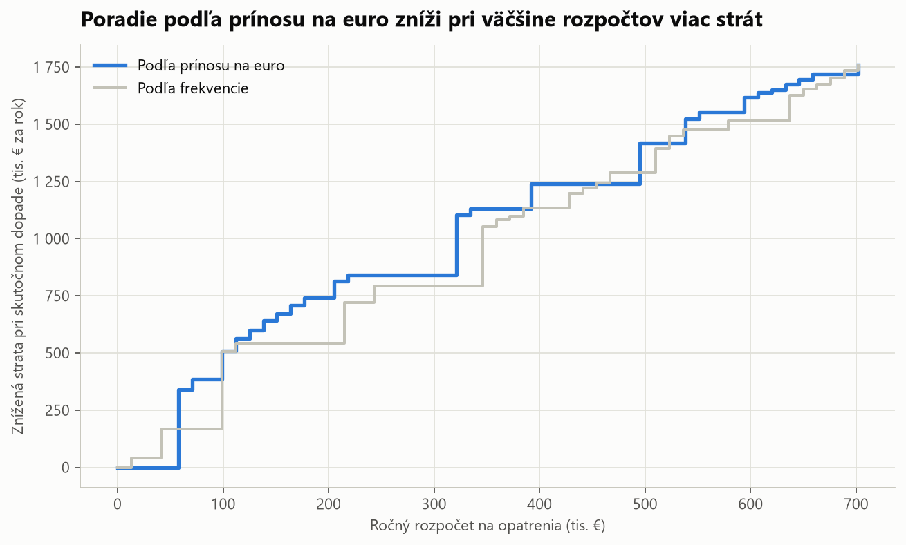
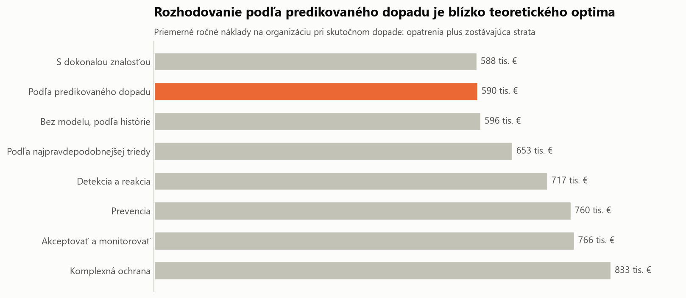

# Dokumentácia: predikcia a preskripcia rizík bezpečnostných incidentov

**Predmet:** AISPU, zadanie č. 2: Prediktívna a preskriptívna údržba
**Zameranie:** Threat Modeling and Risk Assessment (projekt mimo priemyselnej údržby, preto sa predikujú riziká a navrhujú preventívne opatrenia)

## Obsah

1. [Cieľ a zameranie](#1-cieľ-a-zameranie)
2. [Dataset](#2-dataset)
3. [Príprava dát](#3-príprava-dát)
4. [Prediktívna časť](#4-prediktívna-časť)
5. [Preskriptívna časť](#5-preskriptívna-časť)
6. [Aplikácia a integrácia do IS](#6-aplikácia-a-integrácia-do-is)
7. [Štruktúra projektu a spustenie](#7-štruktúra-projektu-a-spustenie)
8. [Splnenie požiadaviek zadania](#8-splnenie-požiadaviek-zadania)
9. [Obmedzenia](#9-obmedzenia)

---

## 1. Cieľ a zameranie

Cieľom je rozšíriť informačný systém o modul, ktorý:

1. **predikuje** dopad bezpečnostného incidentu, teda koľko záznamov pravdepodobne unikne, z informácií známych hneď po jeho odhalení,
2. **navrhuje** preventívne opatrenia pre jednotlivé scenáre hrozby podľa rizika, nákladov, času zavedenia a priority.

Analógia s priemyselnou údržbou: incident zodpovedá poruche, vzor útoku typu poruchy, predikovaný dopad závažnosti poruchy a opatrenia CIS Controls zásahom údržby.

## 2. Dataset

| Vlastnosť | Hodnota |
| --- | --- |
| Názov | VERIS Community Database (VCDB) |
| Zdroj | <https://github.com/vz-risk/VCDB>, súbor `data/joined/vcdb.json.zip` |
| Verzia | commit `5ebf2f5` z 10. 11. 2026, overená kontrolným súčtom SHA-256 |
| Licencia | CC BY-SA 4.0, Verizon RISK Team a prispievatelia VCDB |
| Počet záznamov | **10 047** incidentov (zadanie vyžaduje aspoň 1 000) |
| Formát | JSON podľa štandardu VERIS |

Každý incident opisuje model hrozby **4A**: kto útočil (*Actor*), ako (*Action*), na aké aktívum (*Asset*) a čo narušil (*Attribute*: dôvernosť, integrita, dostupnosť). K tomu pridáva odvetvie a veľkosť obete a pri úniku dát aj počet uniknutých záznamov.

**Prečo VCDB, a nie CVE.** Predchádzajúca verzia projektu používala dataset zraniteľností CVE. Ten opisuje slabiny v softvéri, nie útoky, takže z neho nie je známe, kto útočí, čo sa stalo ani aký bol dopad. Hodnotenie rizika potrebuje pravdepodobnosť aj dopad, a tie VCDB poskytuje.

Dáta sa do repozitára neukladajú. Modul [vcdb_data.py](vcdb_data.py) ich stiahne do `data/raw/vcdb/` a overí kontrolný súčet.

## 3. Príprava dát

Notebook: [priprava_dat.ipynb](priprava_dat.ipynb)

### 3.1 Kontrola kvality

| Zistenie | Počet |
| --- | ---: |
| Incidenty spolu | 10 047 |
| Riadky so zdieľaným `incident_id` | 67 |
| z toho úplne zhodné kópie | 2 |
| Nepotvrdené incidenty (`Suspected`, `Near miss`) | 81 |
| Stav analýzy `Ineligible` | 4 |
| Nenáhodne vybrané incidenty | 1 937 |
| Incidenty zo zdrojov s aspoň 20 incidentmi | 1 737 |
| Známy počet uniknutých záznamov | 5 127 |

Hlavné zistenia:

- `incident_id` nie je jedinečný, preto sa mažú iba úplne zhodné kópie a pridáva sa vlastný kľúč `zaznam_id`.
- Časť incidentov bola do VCDB doplnená cielene, napríklad zo zdravotníctva. Tie by skreslili odhad pravdepodobnosti.
- Niektoré zdroje pridali naraz stovky incidentov, napríklad zoznam 751 incidentov rezortu U.S. Department of Veterans Affairs alebo obete útoku na MOVEit v roku 2023.

### 3.2 Čistenie

| Krok | Postup | Dôvod |
| ---: | --- | --- |
| 1 | Odstrániť úplne zhodné kópie (2) | Nenesú novú informáciu |
| 2 | Ponechať iba potvrdené incidenty (−81) | Podozrenia nie sú incidenty |
| 3 | Odstrániť záznamy `Ineligible` (−3) | Analytik ich označil za nevhodné |
| 4 | Pridať kľúč `zaznam_id` | `incident_id` nie je jedinečný |
| 5 | Rozbaliť vnorený JSON do plochých stĺpcov podľa modelu 4A | Modely potrebujú tabuľku |
| 6 | Hodnotu `Unknown` ponechať ako kategóriu | Vo VERIS je to vedomé označenie chýbajúcej informácie |
| 7 | Zjednotiť veľkosť organizácie a odvetvie (kódy NAICS → 24 odvetví) | Pôvodné kódy sú príliš podrobné |
| 8 | Doplniť odvodené stĺpce | Trieda dopadu, vzor útoku, čas odhalenia, ransomvér |
| 9 | Označiť nenáhodný výber a hromadné zdroje | Pravdepodobnosť sa počíta iba z reprezentatívnej časti |

**Výsledok:** 9 961 incidentov a 50 stĺpcov. Z toho 6 270 reprezentatívnych incidentov (náhodne vybraných a mimo hromadných zdrojov) a 5 097 incidentov so známym dopadom. Správnosť čistenia overujú tvrdenia (`assert`) v časti 3 notebooku.

### 3.3 Odvodené stĺpce

**Trieda dopadu** podľa počtu uniknutých záznamov:

| Trieda | Počet záznamov | Incidenty |
| --- | --- | ---: |
| `nízky` | menej ako 1 000 | 2 431 |
| `stredný` | 1 000 až 99 999 | 1 783 |
| `vysoký` | 100 000 a viac | 883 |

**Vzor útoku** zjednodušene podľa klasifikácie správy Verizon DBIR. Incidentu sa priradí prvý vzor v poradí, ktorého pravidlu vyhovuje:

| Poradie | Vzor útoku | Pravidlo |
| ---: | --- | --- |
| 1 | Odopretie služby | hacking typu DoS |
| 2 | Strata a krádež aktív | krádež alebo strata zariadenia či nosiča |
| 3 | Chyby | akákoľvek chyba (`error`) |
| 4 | Zneužitie oprávnení | zneužitie prístupu (`misuse`) |
| 5 | Sociálne inžinierstvo | phishing, podvod (`social`) |
| 6 | Útok na webovú aplikáciu | hacking cez webovú aplikáciu bez malvéru |
| 7 | Prienik do systému | ostatný hacking alebo malvér |
| 8 | Ostatné | všetko ostatné, napríklad skimmery |

### 3.4 Analýza

| Vzor útoku | Podiel incidentov | Vysoký dopad | Medián záznamov |
| --- | ---: | ---: | ---: |
| Chyby | 19,0 % | 15,6 % | 230 |
| Strata a krádež aktív | 18,3 % | 6,9 % | 1 407 |
| Zneužitie oprávnení | 17,2 % | 5,8 % | 37 |
| Prienik do systému | 17,1 % | 40,7 % | 28 000 |
| Útok na webovú aplikáciu | 12,7 % | 44,0 % | 46 000 |
| Ostatné | 9,0 % | 16,5 % | 1 623 |
| Sociálne inžinierstvo | 4,1 % | 20,4 % | 2 824 |
| Odopretie služby | 2,6 % | 40,0 % (iba 5 incidentov) | 34 000 |

Zistenia:

- Externí aktéri stoja za 58,7 % incidentov, interní za 37,4 %. Interné incidenty sú najmä chyby (52,0 %) a zneužitie oprávnení (44,6 %).
- Častosť a dopad spolu nesúvisia. Najčastejšie sú chyby, najväčší dopad majú webové útoky a prieniky do systému.
- Každé odvetvie má iný hlavný scenár: v zdravotníctve strata a krádež aktív (43,2 %), v odvetví informácií webové útoky (34,3 %), v maloobchode skimmery (41,8 %).
- Zneužitie oprávnení sa odhalí najneskôr, v 50,3 % prípadov až po rokoch.

### 3.5 Vizualizácie

| Súbor | Čo ukazuje |
| --- | --- |
| [figures/1_matica_rizika.png](figures/1_matica_rizika.png) | Matica rizika: pravdepodobnosť vzoru útoku (os x) proti podielu incidentov s vysokým dopadom (os y) |
| [figures/2_vzory_podla_odvetvia.png](figures/2_vzory_podla_odvetvia.png) | Teplotná mapa podielu vzorov útokov v 6 najčastejších odvetviach |





### 3.6 Podklady pre preskripciu

Každému vzoru útoku sú priradené opatrenia z rámca **CIS Controls v8** (spolu 24 dvojíc vzor–opatrenie, 15 rôznych opatrení). Opatrenia sú rozdelené na prevenciu, detekciu, obnovu a reakciu. Najširšie pokrytie má CIS 3 Data Protection, ktoré rieši vzory 54,5 % incidentov.

## 4. Prediktívna časť

Notebooky: [predikcia.ipynb](predikcia.ipynb) (hlavný), [predikcia_70_30.ipynb](predikcia_70_30.ipynb) (doplnkový)

### 4.1 Úloha

Viactriedna klasifikácia: z informácií známych hneď po odhalení incidentu predikovať triedu dopadu `nízky`, `stredný` alebo `vysoký`.

**Vstupné znaky (232 po zakódovaní):**

| Typ | Stĺpce | Spracovanie |
| --- | --- | --- |
| Viac hodnôt | spôsob útoku, vektor, aktér, aktívum, typ dát, motív, spôsob odhalenia | binárny príznak pre každú hodnotu, ktorá sa vyskytne aspoň v 5 incidentoch |
| Kategória | odvetvie, veľkosť organizácie, krajina, cielenosť, vzor útoku | one-hot, zriedkavé hodnoty (pod 20) sa zlúčia |
| Áno a nie | 21 príznakov aktéra, akcie, aktíva, integrity, dostupnosti, ransomvéru | priamo 0 a 1 |

**Prevencia úniku informácií (data leakage).** Vstupom nie je popis incidentu (v 1 004 popisoch je priamo počet dotknutých osôb), počet záznamov, čas odhalenia, stav úniku dát ani spôsob výberu do databázy.

### 4.2 Rozdelenie dát

- Delí sa podľa zdroja incidentu (`StratifiedGroupKFold`), aby takmer rovnaké incidenty z jedného článku neboli v tréningu aj v teste.
- Hromadné zdroje (aspoň 20 incidentov) sú vždy iba v tréningu. Prvý pokus ukázal, že zoznam 687 incidentov VA v teste skresľoval výsledok (macro F1 0,80 vďaka jednému zoznamu).
- **Tréning:** 3 157 bežných + 888 hromadných incidentov. **Test:** 1 052 bežných incidentov (približne 25 %), použitý iba raz.
- Parametre sa vyberajú 5-násobnou krížovou validáciou na tréningovej časti, opäť so zachovaním skupín.

### 4.3 Algoritmy

| Algoritmus | Princíp | Vybrané parametre |
| --- | --- | --- |
| **Logistická regresia** | Lineárny model, každý znak má pre každú triedu jednu váhu. Rýchly a dobre vysvetliteľný. | `C = 0,3` z {0,1; 0,3; 1; 3} |
| **LightGBM** | Gradient boosting nad rozhodovacími stromami. Každý ďalší strom opravuje chyby predchádzajúcich, zachytí aj kombinácie znakov. | 31 listov, 100 stromov, learning rate 0,05 |
| Triviálny model | Vždy predikuje najčastejšiu triedu, slúži ako spodná hranica | – |

Oba modely používajú `class_weight="balanced"`, aby nebola prehliadnutá málo početná trieda `vysoký`. Parametre sa vyberajú podľa macro F1.

**Kalibrácia.** Váhy tried skresľujú pravdepodobnosti. Preskripcia však potrebuje pravdivé pravdepodobnosti, preto sa nad výstupom modelu učí kalibrátor (multinomická logistická regresia nad logaritmami pravdepodobností) na predikciách z krížovej validácie.

### 4.4 Metriky

| Metrika | Čo meria |
| --- | --- |
| **Macro F1** | Hlavná metrika. Priemer F1 všetkých tried, každá trieda má rovnakú váhu. |
| **Accuracy** | Podiel správnych predikcií. Pri nevyvážených triedach môže klamať. |
| **MAE poradia** | Priemerná vzdialenosť tried (`nízky` = 0, `vysoký` = 2). Menej je lepšie. |
| **Recall a precision `vysoký`** | Koľko incidentov s vysokým dopadom model zachytí a ako často je poplach správny. |
| **Log loss** | Kvalita kalibrovaných pravdepodobností. Menej je lepšie. |

### 4.5 Výsledky na testovacích dátach (1 052 incidentov)

| Metrika | Triviálny model | Logistická regresia | LightGBM |
| --- | ---: | ---: | ---: |
| Macro F1 | 0,191 | 0,656 | **0,660** |
| Accuracy | 0,401 | 0,652 | **0,659** |
| MAE poradia | 0,807 | 0,399 | **0,392** |
| Recall `vysoký` | 0,000 | **0,785** | 0,767 |
| Precision `vysoký` | 0,000 | **0,597** | 0,585 |
| Log loss | 1,079 | 0,759 | **0,735** |

**Spoľahlivosť rozdielov** (bootstrap po skupinách, 500 opakovaní, LightGBM mínus logistická regresia):

| Rozdiel | Priemer | 95 % interval | Záver |
| --- | ---: | --- | --- |
| Macro F1 | +0,004 | [−0,016; 0,024] | nevýznamný |
| Recall `vysoký` | −0,019 | [−0,062; 0,020] | nevýznamný |
| Log loss | −0,025 | [−0,039; −0,010] | **LightGBM má lepšie pravdepodobnosti** |

**Záver:** oba modely jasne prekonávajú triviálny model a v triedení sú vyrovnané. **Vybraný je LightGBM**, lebo má spoľahlivo lepšie kalibrované pravdepodobnosti, z ktorých preskripcia počíta očakávané straty. Bol vybraný aj podľa krížovej validácie (0,636 oproti 0,625), nie podľa testu.

Vysoký dopad predikujú najmä stratené zálohovacie pásky a disky, odvetvie informácií, prístup k nechráneným adresám webu (*Forced browsing*), chybná konfigurácia a správcovia systémov. Nízky dopad predikujú omylom doručené zásielky, papierové dokumenty a zneužitie prístupu bežnými zamestnancami.





### 4.6 Doplnková úloha: 2 triedy a rozdelenie 70:30

[predikcia_70_30.ipynb](predikcia_70_30.ipynb) rieši zjednodušenú úlohu `nízky alebo stredný` proti `vysoký` s náhodným rozdelením 70:30 (seed 67). Test má 1 530 incidentov.

| Metrika | Triviálny model | Logistická regresia | LightGBM |
| --- | ---: | ---: | ---: |
| Macro F1 | 0,453 | 0,755 | **0,788** |
| Accuracy | 0,827 | 0,827 | **0,865** |
| Recall `vysoký` | 0,000 | **0,819** | 0,758 |
| Precision `vysoký` | 0,000 | 0,501 | **0,584** |
| ROC AUC | 0,500 | 0,905 | **0,912** |

Tu má LightGBM spoľahlivo vyššie macro F1 (rozdiel 0,033, interval [0,011; 0,053]) a logistická regresia vyšší recall. Výsledky nie sú priamo porovnateľné s hlavnou úlohou, lebo úloha je ľahšia a náhodné rozdelenie nerešpektuje zdroj incidentu. Grafy: [figures/5_f1_2_triedy.png](figures/5_f1_2_triedy.png), [figures/6_matice_zamen_2_triedy.png](figures/6_matice_zamen_2_triedy.png).

## 5. Preskriptívna časť

Notebook: [preskriptivna_udrzba.ipynb](preskriptivna_udrzba.ipynb)

### 5.1 Scenáre rizika

**48 scenárov** = 6 najčastejších odvetví (zdravotníctvo, verejná správa, financie, informácie, vzdelávanie, maloobchod) × 8 vzorov útokov.

- **Pravdepodobnosť (frekvencia za rok):** modelová organizácia má 1 závažný incident ročne. Ten sa rozdelí medzi vzory podľa ich podielu v danom odvetví medzi reprezentatívnymi incidentmi.
- **Dopad:** priemer kalibrovaných pravdepodobností LightGBM pre testovacie incidenty daného odvetvia a vzoru. Ak ich je menej ako 10, použije sa iba vzor, prípadne všetky testovacie incidenty (24 scenárov podľa odvetvia a vzoru, 18 iba podľa vzoru, 6 zo všetkých).

### 5.2 Typy opatrení

| Opatrenie | Obsah | Účinok | Zavedenie |
| --- | --- | --- | ---: |
| **Akceptovať a monitorovať** | riziko sa vedome prijme, sleduje sa výskyt | žiadny | 0 mesiacov |
| **Prevencia** | preventívne opatrenia CIS priradené vzoru | o 40 % menej incidentov | 3 mesiace |
| **Detekcia a reakcia** | detekčné a obnovovacie opatrenia CIS a CIS 17 | o 35 % menšia strata z incidentu | 2 mesiace |
| **Komplexná ochrana** | prevencia aj detekcia a reakcia | oba účinky | 4 mesiace |

**Predpoklady** (dataset neobsahuje ceny ani účinnosť opatrení):

| Parameter | Hodnota |
| --- | --- |
| Strata z incidentu | nízky 25 000 €, stredný 250 000 €, vysoký 2 500 000 € |
| Ročná cena jedného opatrenia CIS | prevencia 15 000 €, detekcia 25 000 €, obnova 20 000 €, reakcia 15 000 € |
| Monitorovanie | 2 000 € ročne |
| Horizont | 3 roky |

### 5.3 Rozhodovacia logika

Zohľadňujú sa **4 faktory**:

| Faktor | Ako vstupuje do rozhodnutia |
| --- | --- |
| **Riziko** | očakávaná ročná strata = `frekvencia × Σ P(trieda) × strata triedy` |
| **Náklady** | ročná cena opatrení CIS, ktoré daný typ opatrenia obsahuje |
| **Čas** | opatrenie funguje až po zavedení, takže v horizonte 36 mesiacov chráni iba `(36 − mesiace zavedenia) / 36` času |
| **Priorita** | pri obmedzenom rozpočte poradie podľa čistého prínosu na každé investované euro |

Ročné celkové náklady opatrenia `a`:

```
celkové_náklady(a) = cena(a) + očakávaná_strata × (1 − menej_incidentov(a) × f) × (1 − menšia_strata(a) × f)
f = (36 − mesiace_zavedenia(a)) / 36
```

Pre každý scenár sa **odporučí opatrenie s najnižšími celkovými nákladmi**. Z toho vyplývajú prahy, od akej očakávanej straty sa opatrenie oplatí:

| Vzor útoku | Prevencia od | Detekcia a reakcia od | Komplexná ochrana od |
| --- | ---: | ---: | ---: |
| Odopretie služby | 35 500 € | – | 211 200 € |
| Strata a krádež aktív | – | 39 400 € | 133 000 € |
| Chyby | – | 39 400 € | 199 600 € |
| Zneužitie oprávnení | 138 500 € | 115 000 € | 211 200 € |
| Sociálne inžinierstvo | – | 39 400 € | 199 600 € |
| Útok na webovú aplikáciu | – | 39 400 € | 199 600 € |
| Prienik do systému | 117 300 € | – | 316 800 € |
| Ostatné | 35 500 € | – | 79 200 € |

### 5.4 Odporúčania

| Opatrenie | Scenáre | Zdôvodnenie |
| --- | ---: | --- |
| Akceptovať a monitorovať | 24 | Pri nízkej strate sa žiadne opatrenie (aspoň 15 000 € ročne) nevráti. |
| Prevencia | 4 | Pri prienikoch a odopretí služby je detekcia drahá (sieťový monitoring CIS 13), výhodnejšie je znížiť počet incidentov. |
| Detekcia a reakcia | 14 | Najlacnejší zásah, ktorý zníži stratu každého incidentu, a zavedie sa najrýchlejšie. |
| Komplexná ochrana | 6 | Pri najväčších rizikách sa oplatí znížiť počet incidentov aj ich dopad. |

Najdôležitejšie scenáre:

| Odvetvie | Vzor útoku | Očakávaná strata | Opatrenie | Opatrenia CIS |
| --- | --- | ---: | --- | --- |
| Informácie | Útok na webovú aplikáciu | 548 250 € | Komplexná ochrana | CIS 6, 7, 16, 17 |
| Informácie | Prienik do systému | 428 039 € | Komplexná ochrana | CIS 4, 7, 10, 11, 13, 17 |
| Vzdelávanie | Prienik do systému | 348 977 € | Komplexná ochrana | CIS 4, 7, 10, 11, 13, 17 |
| Maloobchod | Ostatné (skimmery) | 220 981 € | Komplexná ochrana | CIS 1, 17 |
| Zdravotníctvo | Strata a krádež aktív | 111 885 € | Detekcia a reakcia | CIS 11, 17 |

Celý register 48 scenárov s prioritou sa ukladá do `data/processed/vcdb_register_rizik.csv`.

### 5.5 Vyhodnotenie stratégií

Každá stratégia rozhodne z odhadu a potom sa spočítajú jej náklady pri **skutočnom** dopade testovacích incidentov.

| Stratégia | Ročné náklady na organizáciu |
| --- | ---: |
| S dokonalou znalosťou dopadu (teoretické optimum) | 588 393 € |
| **Podľa predikovaného dopadu (naše riešenie)** | **589 913 €** |
| Bez modelu, podľa histórie | 595 506 € |
| Podľa najpravdepodobnejšej triedy | 653 409 € |
| Všade detekcia a reakcia (najlepšia pevná) | 717 111 € |
| Všade prevencia | 760 026 € |
| Všade akceptovať | 766 042 € |
| Všade komplexná ochrana | 832 982 € |

- Naše riešenie je len o 1 520 € horšie ako teoretické optimum.
- Oproti najlepšej pevnej stratégii ušetrí **17,7 %** (95 % interval úspory pre 6 organizácií [679 897; 833 757] € ročne).
- Využitie celého rozdelenia pravdepodobností je lepšie ako rozhodovanie iba podľa najpravdepodobnejšej triedy, lebo pri riziku záleží aj na málo pravdepodobnom, ale veľmi drahom výsledku.
- Oproti rozhodovaniu iba z historických dát je prínos malý (menej ako 1 %), lebo na úrovni celých scenárov sa priemer predikcií blíži historickému priemeru.

**Priorita pri obmedzenom rozpočte:** všetky odporúčané opatrenia stoja 702 000 € ročne. Pri rozpočte 250 000 € zníži poradie podľa prínosu na euro stratu o 841 186 €, poradie iba podľa frekvencie o 791 510 €.

**Citlivosť:** pri zmene strát, cien, počtu incidentov, účinnosti a horizontu riešenie vždy prekonalo najlepšiu pevnú stratégiu, s úsporou od 6,7 % do 17,7 %.







## 6. Aplikácia a integrácia do IS

| Súčasť | Súbor | Úloha |
| --- | --- | --- |
| Frontend | [app.py](app.py) | Webová aplikácia Streamlit na <http://localhost:8501> |
| API | [api.py](api.py) | REST API (FastAPI) na <http://localhost:8000>, dokumentácia na `/docs` |
| Logika modelu | [opatrenia.py](opatrenia.py) | Prevod vstupu na znaky, predikcia dopadu, výber opatrenia, databáza |
| Znaky modelu | [vcdb_model.py](vcdb_model.py) | Príprava znakov a kalibrované pravdepodobnosti, potrebné na načítanie modelu |
| Databáza | SQLite, tabuľka `hodnotenia` | Uložené hodnotenia z aplikácie aj z API |
| Nasadenie | [Dockerfile](Dockerfile), [compose.yaml](compose.yaml) | Kontajnery `app` a `api`, spoločná databáza vo volume Dockeru |

### 6.1 Priebeh hodnotenia

1. Analytik zadá incident tak, ako ho pozná hneď po odhalení: odvetvie, veľkosť organizácie, krajinu, cielenosť, typ aktéra a typ útoku, podrobné hodnoty (podrobný typ aktéra, spôsob a vektor útoku, aktívum, typ dát, motív, spôsob odhalenia) a či bola narušená integrita alebo dostupnosť. Formulár ponúka iba hodnoty, ktoré sa v `vcdb_clean.csv` vyskytujú aspoň 5-krát, lebo iné model nepozná.
2. [opatrenia.py](opatrenia.py) prevedie vstup na riadok v tvare `vcdb_clean.csv`. Príznaky aktéra a akcie sa berú zo samostatného výberu typu aktéra a útoku, doplnené o typy, ktoré vyplývajú z podrobných hodnôt. Samostatný výber je nutný, lebo napríklad partner často nemá uvedený podrobný typ. Príznaky aktív a ransomvéru sa odvodia z podrobných hodnôt a vzor útoku rovnakými pravidlami ako v `priprava_dat.ipynb`.
3. Uložený model LightGBM vráti kalibrované pravdepodobnosti tried dopadu (`calibrated_probabilities` z `vcdb_model.py`).
4. Ročná frekvencia sa predvyplní podielom vzoru útoku v odvetví medzi reprezentatívnymi incidentmi (rovnako ako v notebooku) a analytik ju môže zmeniť.
5. Opatrenie sa vyberie rovnakým výpočtom ako v [preskriptivna_udrzba.ipynb](preskriptivna_udrzba.ipynb): rovnaké predpoklady, opatrenia CIS z `vcdb_opatrenia_cis.csv` a opatrenie s najnižšími celkovými nákladmi, iba pre jeden zadaný incident.
6. Výsledok sa uloží do tabuľky `hodnotenia` v SQLite.

**Overenie.** Príkaz `python opatrenia.py` prevedie 1 052 testovacích incidentov na vstup formulára a porovná pravdepodobnosti s predikciou modelu priamo nad pôvodným riadkom z `vcdb_clean.csv`. Najpravdepodobnejšia trieda aj vzor útoku sa zhodujú pri všetkých incidentoch, priemerný rozdiel pravdepodobnosti je 0,00003 a rozdiel nad 0,01 majú iba 2 incidenty (najviac 0,021), lebo obsahujú zriedkavé hodnoty, ktoré formulár neponúka. Bez samostatného výberu typu aktéra a útoku by sa líšilo 103 incidentov, najviac o 0,16. Výber opatrenia dáva pre všetkých 48 scenárov registra rovnaké opatrenie a stratu ako notebook.

### 6.2 Frontend

| Záložka | Obsah |
| --- | --- |
| Nové hodnotenie | formulár incidentu, pravdepodobnosti dopadu, očakávaná ročná strata, odporúčané opatrenie s opatreniami CIS a porovnanie všetkých 4 opatrení. Tlačidlo *Náhodný testovací incident* vyplní formulár incidentom z testovacej časti dát a ukáže jeho skutočný dopad. |
| Uložené hodnotenia | záznamy z databázy zoradené podľa očakávanej straty, vstup hodnotenia, export do CSV, vymazanie |
| Prehľad | grafy z uložených hodnotení: počet v čase podľa predikovaného dopadu, kumulatívna očakávaná strata, odporúčané opatrenia, najčastejšie vzory útokov; obnovujú sa každých 5 sekúnd |
| Register rizík | 48 scenárov z `vcdb_register_rizik.csv`, interaktívna mapa rizík, krivka zníženej straty s posuvníkom rozpočtu a porovnanie stratégií, počítané z `vcdb_predikcie.csv` rovnako ako grafy 7 až 9 |
| Predpoklady | straty, ceny a účinnosť opatrení, ceny podľa vzoru útoku a prahy, od ktorých sa opatrenie oplatí |

### 6.3 REST API

| Metóda | Cesta | Popis |
| --- | --- | --- |
| GET | `/api/moznosti` | povolené hodnoty polí incidentu |
| POST | `/api/hodnotenie` | vyhodnotí incident a uloží výsledok do databázy, pri neplatnom vstupe vráti 422 so zoznamom chýb |
| GET | `/api/hodnotenia` | uložené hodnotenia zoradené podľa očakávanej straty |
| GET | `/api/register` | register rizík z preskriptívnej analýzy |

Aplikácia aj API používajú rovnaký modul `opatrenia.py` a rovnakú databázu, takže hodnotenie pridané cez API sa hneď zobrazí v aplikácii.

## 7. Štruktúra projektu a spustenie

```
├── vcdb_data.py                 stiahnutie a overenie VCDB
├── vcdb_model.py                príprava znakov a kalibrované pravdepodobnosti
├── priprava_dat.ipynb           1. príprava dát a analýza
├── predikcia.ipynb              2. predikcia dopadu (3 triedy)
├── predikcia_70_30.ipynb        2b. predikcia dopadu (2 triedy, 70:30)
├── preskriptivna_udrzba.ipynb   3. preskripcia opatrení
├── opatrenia.py                 hodnotenie incidentu a databáza
├── app.py, api.py               aplikácia Streamlit a REST API
├── figures/                     vizualizácie 1 až 9
└── data/                        dáta a modely (mimo gitu)
```

```powershell
python -m venv .venv
.venv\Scripts\Activate.ps1
pip install -r requirements.txt
jupyter nbconvert --to notebook --execute --inplace priprava_dat.ipynb
jupyter nbconvert --to notebook --execute --inplace predikcia.ipynb
jupyter nbconvert --to notebook --execute --inplace predikcia_70_30.ipynb
jupyter nbconvert --to notebook --execute --inplace preskriptivna_udrzba.ipynb
```

Notebooky sa spúšťajú v tomto poradí, lebo každý používa výstupy predchádzajúceho. Aplikácia a API: `docker compose up -d --build`, podrobnosti v [README.md](README.md).

## 8. Splnenie požiadaviek zadania

| Oblasť | Požiadavka | Splnenie |
| --- | --- | --- |
| Príprava dát | dataset aspoň 1 000 záznamov, čistenie, analýza, 2 vizualizácie | 10 047 incidentov, 9 krokov čistenia, analýza v 5 častiach, vizualizácie 1 a 2 |
| Prediktívna údržba | 2 ML algoritmy, porovnanie, metriky | logistická regresia a LightGBM, Macro F1, Accuracy, MAE, recall, precision, log loss, ROC AUC, bootstrap |
| Preskriptívna údržba | aspoň 3 typy opatrení, aspoň 2 faktory, zdôvodnenie | 4 typy opatrení, 4 faktory (riziko, náklady, čas, priorita), prahy a zdôvodnenie |
| Integrácia do IS | API, frontend, databáza | REST API vo FastAPI, aplikácia Streamlit, databáza SQLite, všetko nad modelom VCDB a v Dockeri |
| Dokumentácia | algoritmy, výsledky, rozhodovacia logika | tento dokument a [VYSVETLENIE.md](VYSVETLENIE.md) |
| BPMN | diagram procesu | splnené v rámci zadania č. 1 |

## 9. Obmedzenia

- VCDB obsahuje iba verejne známe incidenty, 73 % obetí je z USA.
- Dopad je meraný počtom záznamov, nie peniazmi. Finančnú stratu uvádza iba 324 incidentov.
- Ceny, účinnosť opatrení a straty sú predpoklady. Pri skutočnom použití ich treba nahradiť údajmi organizácie.
- Precision triedy `vysoký` je približne 0,59, teda zhruba 4 z 10 poplachov sú zbytočné.
- Opatrenia sa počítajú pre každý scenár zvlášť. Opatrenia spoločné pre viac vzorov by v skutočnosti stáli menej.
- Od roku 2022 obsahuje VCDB málo náhodne vybraných incidentov, dáta sa preto nehodia na sledovanie vývoja v čase.
